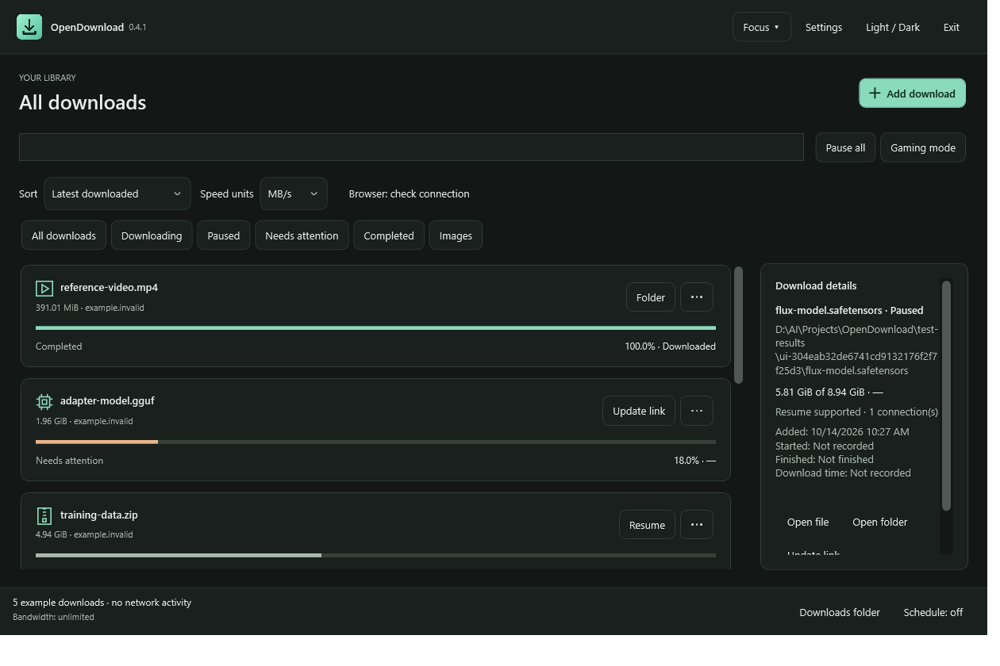
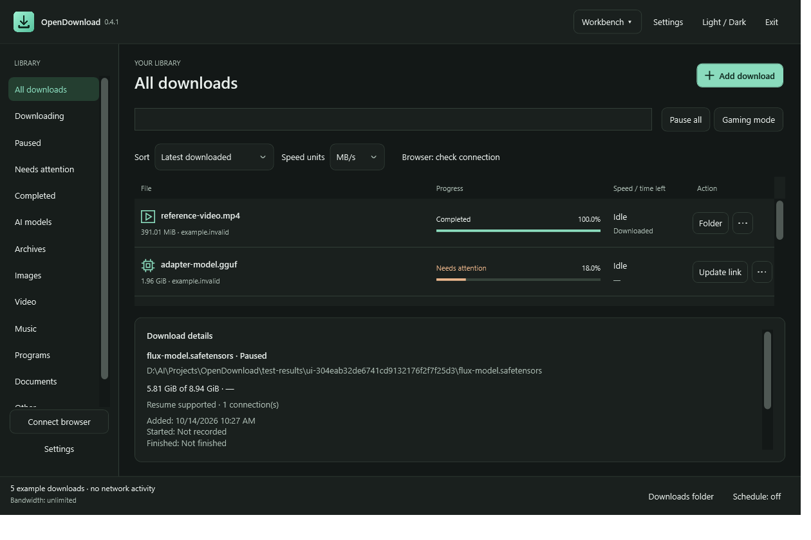

# OpenDownload

[](https://github.com/Renz1998/OpenDownload/releases/download/v0.4.1/OpenDownload-0.4.1-Setup.exe)

**[Download OpenDownload 0.4.1 for Windows (.exe)](https://github.com/Renz1998/OpenDownload/releases/download/v0.4.1/OpenDownload-0.4.1-Setup.exe)**

Windows 11, 64-bit. Download and run the installer; the .NET runtime is included.

[Portable ZIP](https://github.com/Renz1998/OpenDownload/releases/download/v0.4.1/OpenDownload-0.4.1-win-x64.zip) | [Release notes and checksums](https://github.com/Renz1998/OpenDownload/releases/tag/v0.4.1) | [Browser extension setup guide](docs/browser-setup.html)

A free, open-source download manager for Windows 11. A familiar toolbar, category sidebar and download table, with an independent transfer engine and Chrome/Edge extension. No trial, account, ads or subscription.

**Version 0.4.1 is a preview release, not full IDM parity.** OpenDownload has its own branding, source code and browser helper. It does not replace IDM's helper, reset its trial, or redistribute its extension.

## See the app

Actual screenshots of OpenDownload 0.4.1 with example downloads. Switch between these layouts at any time using the menu at the top of the app.

### Focus (default)

A simple card view with progress, quick actions and download details.



### Workbench

A download table with a category sidebar for managing a larger library.



## Features

- Focus mode by default, a first-launch Workbench/Focus chooser, remembered layout and a permanent switch.
- Graphite/teal interface, light/dark themes, contextual row actions and compact Workbench density.
- Gaming mode applies a configurable shared bandwidth cap and restores the prior setting.
- Illustrated browser setup with Chrome/Edge buttons, folder copy/open actions and actual connection-check timestamps. See [the full guide](docs/browser-setup.html).

- HTTP/HTTPS downloads with up to eight connections when the server supports validated byte ranges.
- Pause/resume, restart, retry after transient connection failure, and crash recovery.
- Shared bandwidth cap, concurrent download limit and daily queue scheduling, including windows spanning midnight.
- Batch URLs, filename search, categories, progress/connection details, tray controls and completion notifications.
- SHA-256 calculation, collision-safe filenames and no overwrite of completed files.
- SQLite history; URLs and authentication headers encrypted with Windows DPAPI for the current user.
- Manual Bearer/Authorization and Cookie headers for authenticated downloads; origin-sensitive redirects.
- Chrome/Edge Manifest V3 extension: link/media context menu, selected URL batches, URL popup, connection check and optional download capture limited to specified hosts.
- Self-contained Windows x64 package and per-user browser registration without administrator rights.

## Run

Run `OpenDownload-0.4.1-Setup.exe` for per-user installation, shortcuts and automatic browser-helper registration. Close OpenDownload using Exit before upgrading. The installer preserves preferences, downloads, unrelated files and the previous program folder as a recovery backup. Uninstall through Windows Settings → Apps; downloaded files, settings/history and the cached installer are kept. Alternatively extract the portable ZIP and launch `OpenDownload.Desktop.exe`. The .NET runtime is included.

New installations save files to your Windows **Downloads** folder (`C:\Users\<user>\Downloads` on a typical setup). Existing custom download folders are preserved. Change the location, speed limit, connection count and schedule in **Settings**. Your settings and encrypted history live at `%LOCALAPPDATA%\OpenDownload`. Set `OPENDOWNLOAD_DATA` before launch to use another local data folder, or put its absolute path in `data-path.txt` beside the app. The environment variable takes priority. Keep that machine-specific file out of shared release packages.

**Closing the window keeps the app in the tray by default.** Use the tray menu's **Exit** to stop it, or disable close-to-tray in Options. Downloads need Windows awake and the app running; there is no Windows service or automatic startup task.

The EXE installer is the recommended path. Portable users can create a shortcut manually or use `scripts\Install.ps1`; no execution-policy change is necessary to launch the app directly.

## Chrome / Edge setup

1. Open `chrome://extensions` or `edge://extensions`.
2. Enable **Developer mode**, select **Load unpacked**, and choose the release's `browser-extension` folder.
3. In OpenDownload choose **Connect browser** and click **Prepare helper and open extensions**. The stable extension ID is registered automatically.
4. Click **Copy folder path**, paste it into the browser folder picker and choose **Select Folder**.
5. Click **Open extension and check connection**, or open the extension popup and choose **Check connection**. You should see “Connected to OpenDownload.”

Registration creates only `org.opendownload.app` under your current-user Chrome, Edge and Chromium native-messaging registry keys. It does not modify IDM. The extension sends messages to the helper, which forwards them through a same-user named pipe to the desktop app. It can start the app when needed.

Right-click a link, image or directly accessible video/audio file and select **Download with OpenDownload**. Alternatively paste a URL into the popup. Selected text can contain one or more complete URLs. This version does not inject a floating video panel into websites.

**Automatic capture is off by default.** Enable it only for downloads you want to hand over. A comma-separated host list restricts capture to exact hostnames. Private/incognito downloads are excluded. If the desktop handoff fails, the extension attempts to resume the browser download. Acceptance means the app saved the request, not that the server has authorized it or the transfer will succeed. Downloads requiring cookies may fail after handoff; use manual downloading for those sites.

No browsing-history collection, automatic cookie extraction or broad website-read permission is used. Unpacked extensions are a development distribution; browser-store distribution and store reviews are separate work.

## Resume and integrity

The engine checks ETag (or Last-Modified), length and range support before resuming, and checks each partial response. Changed sources, invalid ranges and ignored resume requests stop safely. Servers without a usable validator or ranges use one connection; a stopped transfer from such a server may require **Restart**. **Replace URL** lets you supply a fresh signed link for the same file, but resume still requires matching metadata.

Writes are flushed before persisted offsets advance. Completed files receive a SHA-256 digest, visible in the details area. This calculated digest detects differences when compared to a trusted publisher checksum; it is not independent proof of authenticity. Free-space checks are approximate on network drives and when other applications consume space concurrently; write failures remain errors rather than completed downloads.

**Remove from list** hides an entry while keeping its encrypted record and partial file for recovery. **Clear completed** hides completed entries. **Undo** or **More → Restore removed entries** restores them. Restart discards a selected incomplete file after confirmation.

## Build and test

Install .NET SDK 10.0.401 and Node.js 24 or newer, then:

```powershell
./scripts/Build.ps1 -Publish
```

Or run the commands individually:

```powershell
dotnet build src/OpenDownload.Desktop -c Release
dotnet build src/OpenDownload.NativeHost -c Release
dotnet run --project tests/OpenDownload.Tests -c Release -- .
```

The test harness starts a localhost-only Node HTTP fixture. It checks exact file hashes for segmented and single-stream downloads, pause/serialization/resume, connection resets, unknown-length responses, redirects and authentication; also changed-source refusal, invalid ranges, HTTP errors, empty files, no overwrite, bandwidth limits, schedule windows and safe filenames. No real user URLs or external download traffic are needed.

There are 19 transfer tests, eight Windows persistence tests, eight extension behavior tests and 13 UI checks, plus six native integration checks and six installer lifecycle checks. Transfer tests include forced process termination and recovery, and stripping credentials on cross-origin redirects. UI checks render both layouts, exercise the welcome chooser and layout switch, and verify gaming-cap restoration and undo. Extension behavior tests use mocked browser APIs; browser installation still requires the manual approval steps above.

`tests/native-smoke.py` also tests the published app and binary native-messaging protocol end to end. It needs Python 3 and a fresh test data directory, and must run with other OpenDownload instances closed:

```powershell
python tests/native-smoke.py --app artifacts/OpenDownload --data test-results/native-smoke --root .
```

The portable ZIP, self-contained Setup EXE and SHA-256 checksums are written to `artifacts/`. GitHub Actions runs the test suites, tests the published helper and installer, then publishes the current version's preview release. Existing releases are preserved. Packages are currently unsigned; code signing is not configured.

## Scope and roadmap

Implemented: normal downloads, direct media-file URLs, manual authentication, desktop queue/scheduler and an independent browser extension.

Not implemented: IDM's proprietary extension protocol, arbitrary website video extraction, HLS/DASH assembly, DRM-protected media, FTP, recursive site crawling, multiple named queues, automatic cookie/token extraction, automatic URL refresh, automatic application updates or browser-store publishing. Server limits still apply; extra connections do not guarantee faster downloads.

IDM extension feasibility: the locally installed `IDMMsgHost.json` registers `com.tonec.idm` with an IDM-specific executable and extension IDs. No documented replacement-app protocol was identified. OpenDownload intentionally registers a separate helper. No proprietary extension source or binaries are included in this project.

## Contributing and privacy

Do not commit local databases, partial files, signed download links, access tokens, cookies, browser profiles or personal logs. The repository ignores generated builds, download history and test output. DPAPI protects local records for the current Windows account; moving the database to a different account will not decrypt it.

The app performs no telemetry and stores no credentials on GitHub. Report bugs with test URLs and redacted reproduction steps. Dependencies and their licenses are listed in `THIRD-PARTY.md`.

## Help me build more things

Enjoying OpenDownload? [Buy me a coffee on Ko-fi](https://ko-fi.com/renzuwu) and help me keep making useful little tools. Support is optional; OpenDownload stays free and open source.

## License

MIT. See `LICENSE`. IDM is a trademark of its respective owner; this project is independent and unaffiliated.
